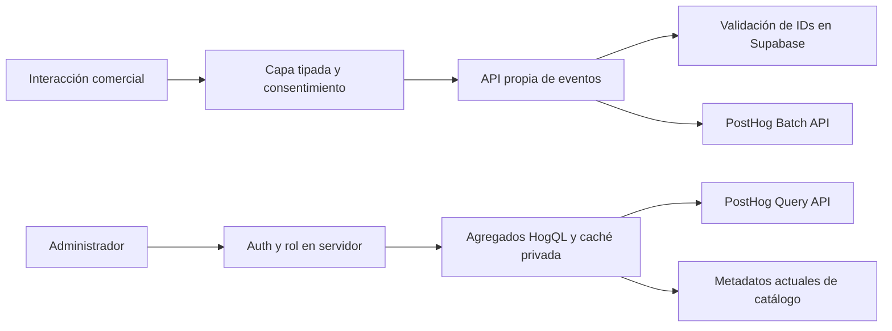

# KILLAQ · Estadísticas e inteligencia comercial

Implementación preparada inicialmente en local, revisada el 13 de octubre de 2026. Se incorpora al Admin 2.0 existente en `/admin/estadisticas`. Se conservó el diseño de la tienda. La publicación posterior junto con recuperación y redes se documenta en `ACCOUNT_RECOVERY_SOCIAL.md`; no se contrataron servicios ni se activó seguimiento en producción.

## Resultado y estado real

El módulo contiene resumen, evolución diaria, productos, recorrido ordenado, categorías, campañas, CTA, procedencia/UTM, dispositivos, búsquedas protegidas y estado de medición. Admite 7, 30 y 90 días completos y rangos personalizados de hasta 90 días, con hora de Perú. Las consultas están reservadas a administradores verificados por Supabase Auth y `profiles.role`.

La configuración local contiene solamente las variables públicas de Supabase. **Faltan las credenciales de PostHog y la revisión comercial/jurídica; la captura está desactivada.** El panel muestra valores no disponibles, sin estadísticas de demostración. Las capturas con actividad proceden únicamente de fixtures ficticios aislados y no representan visitas o ventas de KILLAQ.

El flujo comercial sigue siendo carrito y coordinación por WhatsApp. No existe un checkout electrónico ni una fuente confiable de pedidos pagados. Se muestran como fuente transaccional no disponible; no se transforma un clic en pedido, ingreso o compra.

## Herramientas y fuentes oficiales

| Herramienta | Decisión y fundamento | Costos/límites consultados |
| --- | --- | --- |
| [PostHog · precios](https://posthog.com/pricing) | Proveedor único de eventos. Integración mediante sus API oficiales, con transporte propio y propiedades permitidas. | 1 millón de eventos gratuitos por mes; Free incluye un proyecto y ventana de eventos de un año. Plan de pago por uso, con límites de facturación configurables y ventana de siete años. Las tarifas adicionales dependen del producto/volumen en su calculadora; no se proyectó una factura sin tráfico real. |
| [PostHog · Query API](https://posthog.com/docs/api/queries) | Agregados HogQL consultados desde servidor. | Documenta 2400 solicitudes/hora, 240/minuto, tres consultas concurrentes y presupuesto de lectura por proyecto. Hay cuentas con límite heredado de 120/hora. Cola/tiempos y presupuesto pueden provocar 429 o errores; la aplicación los comunica. |
| [GA4 · ecommerce](https://developers.google.com/analytics/devguides/collection/ga4/ecommerce) | Se utilizan nombres y estructura de artículos como convención. No se añadió Google Analytics ni Google Tag Manager. | No se añadió otra cuota ni otro flujo duplicado de medición. La implementación no equivale a configurar una propiedad GA4. |
| [Clarity · FAQ](https://learn.microsoft.com/clarity/faq/) y [Heatmaps](https://learn.microsoft.com/en-us/clarity/heatmaps/heatmaps-features) | Solo enlace administrativo opcional a un proyecto. No hay script, mapas inventados ni grabaciones instaladas. | Servicio gratuito según Microsoft; heatmaps limitados a 100000 vistas por mapa. Su inclusión requiere revisión independiente de los datos y funciones que procesa. |
| [Vercel · Web Analytics](https://vercel.com/docs/analytics/limits-and-pricing) | Analizado, sin instalar para duplicar eventos. | Hobby publica 50000 eventos/mes y un mes de informes; Pro tiene cobro por evento, publicado como USD 0.03/1000, y otras ventanas/opciones. [Hobby se restringe a uso personal no comercial](https://vercel.com/docs/plans/hobby): verificar el plan adecuado para la tienda sin asumir el contratado. |
| [Supabase · funciones](https://supabase.com/docs/guides/database/functions) | Conserva Auth/RLS y aporta metadatos actuales/validación de piezas. No recibe una copia de cada evento. | La carga añadida es validación de IDs y lectura de catálogo/rol, bajo las cuotas del proyecto existente. No se creó un almacén paralelo de analítica. |

Se contrastaron también [captura y batch de PostHog](https://posthog.com/docs/api/capture), [funciones HogQL admitidas](https://posthog.com/docs/sql/clickhouse-functions), [almacenamiento y eliminación](https://posthog.com/docs/privacy/data-storage), [retención de eventos](https://posthog.com/docs/data/events-retention), [privacidad de Vercel](https://vercel.com/docs/analytics/privacy-policy), [datos recogidos por Clarity](https://learn.microsoft.com/en-us/clarity/setup-and-installation/clarity-data) y [Consent API V2 de Clarity](https://learn.microsoft.com/en-us/clarity/setup-and-installation/clarity-consent-api-v2). La API V2 distingue almacenamiento de analítica/publicidad; eso no sustituye la evaluación peruana ni implica que Clarity esté configurado en KILLAQ.

Los precios y condiciones pueden cambiar. Ninguna cuenta, plan o presupuesto privado del proveedor fue verificado con credenciales reales.

## Arquitectura de captura y consulta

`core.ts` define contratos, rutas permitidas, protección de búsquedas/UTM, periodos y cálculos. `client.ts` centraliza cola, IDs UUID, deduplicación de exposiciones/vistas y transporte. Las pantallas llaman a esta capa, sin SDKs dispersos. `AnalyticsProvider` controla contexto, administración, navegador de pruebas y preferencias.

Los eventos se envían en lotes de hasta 20, con espera breve de 250 ms y cuerpo limitado a 16 KB. La cola es de memoria; no guarda actividad pendiente en localStorage. No se reintenta automáticamente un fallo de transporte. La medición puede perder eventos y sigue siendo una estimación: el fallo no bloquea carrito, navegación o WhatsApp.

El servidor exige origen, host de producción autorizado, entorno de producción, autorización firmada y eventos válidos. Comprueba que los productos existan y estén publicados y que las campañas numéricas estén activas. El contacto general y las campañas ilustrativas de portada se distinguen de productos contractuales. Se reserva cada ID antes de enviar para evitar duplicados concurrentes en el mismo proceso y se utiliza el campo nativo `uuid` de PostHog. Las vistas/exposiciones se registran una vez por navegación y elemento; una acción nueva del consumidor puede producir otro evento legítimo.

La captura usa IDs aleatorios de navegador/sesión y `$process_person_profile=false`; no identifica cuentas. No se envía la IP del visitante al proveedor, se desactiva enriquecimiento GeoIP y se limita cada propiedad. Se registra la versión del aviso y la fecha de autorización de la cookie firmada. No se exportan nombres, emails, teléfonos, documentos, mensajes, contenido de formularios o URL completas.

Las consultas administrativas verifican Auth/rol **antes de cualquier caché**, utilizan la clave privada únicamente en servidor y devuelven agregados. Hay caché de 60 segundos, hasta 30 variantes y una petición compartida para consultas iguales en curso; límite local de 12 consultas/minuto por administrador. Los nombres/fotografías se obtienen del catálogo actual, no se recogen en los eventos. Las rutas de captura y consulta declaran una duración máxima de 60 segundos en plataformas compatibles; cada llamada al proveedor mantiene su timeout más corto.

La caché, límites y deduplicación en memoria pertenecen a cada proceso: no son un sistema distribuido de entrega exactamente una vez. Antes de operar con volumen, verificar UUID/deduplicación en el proyecto real y complementar la protección con reglas WAF/presupuesto del proveedor. Un timeout no demuestra que el proveedor no recibiera un evento.

## Eventos implementados

| Evento | Disparador real | Información específica |
| --- | --- | --- |
| `page_view` | Navegación comercial permitida, una vez por contexto | Clase de página, sin ruta/query completa. |
| `view_item_list` | Tarjeta de producto o exclusiva con ≥50 % del área geométrica en viewport durante 1000 ms continuos y documento visible | ID, lista, posición, clasificación confirmada por servidor. |
| `select_item` | Enlace a una pieza desde catálogo, destacados, ofertas, relacionados o exclusiva | ID, lista y posición. |
| `view_item` | Ficha existente abierta | ID, una vez por navegación/producto. |
| `add_to_cart` | Aumento efectivo de unidades, dentro del stock | ID y delta de unidades; fuera de actualizadores de estado React. |
| `remove_from_cart` | Disminución, retirada o vaciado efectivo | ID y delta de unidades retiradas. |
| `view_cart` | Carrito hidratado y disponibilidad consultada correctamente | IDs/cantidades agrupados por producto. |
| `search` | Catálogo cargado correctamente con búsqueda y filtros vigentes | Conceptos canónicos y número de resultados cargados. Nunca texto bruto/hash. |
| `whatsapp_contact_click` | Clic en un enlace explícito de WhatsApp | Ubicación del CTA; no teléfono o mensaje. |
| `product_whatsapp_inquiry` | CTA de carrito que incluye esa pieza en la consulta | ID y cantidad, separado del clic general. |
| `category_selected` | Enlace real de categoría | Categoría permitida y ubicación. |
| `campaign_viewed` | Exposición de la creatividad de portada bajo el criterio de visibilidad | ID verificado o referencia ilustrativa identificada. |
| `campaign_selected` | CTA principal de esa campaña | ID y ubicación de portada. |
| `product_gallery_interaction` | Cambio efectivo a otra fotografía | ID e índice, sin URL de la imagen. |

No se implementa `begin_checkout` o `purchase` porque no existe ese flujo real. Tampoco se emite `size_guide_opened`: no existe un control de guía de tallas operable en la ficha actual. No se añadieron controles ficticios para generar eventos.

La exposición es una condición geométrica de medición, no prueba de lectura, atención o ausencia de toda oclusión. Las consultas por pieza corresponden a las piezas incluidas en el CTA de carrito; no se infiere interés por una pieza solo porque un visitante pulse el WhatsApp genérico del footer.

## Métricas y denominadores

| Indicador | Unidad y cálculo | Interpretación |
| --- | --- | --- |
| Visitantes medidos | IDs aleatorios distintos en el periodo | Navegadores consentidos, no personas identificadas; borrado/rotación/dispositivos pueden cambiar el conteo. |
| Sesiones medidas | IDs de sesión distintos | Inactividad de 30 minutos o máximo de 24 horas. |
| Vistas/selecciones/añadidos/consultas | Eventos válidos de cada tipo | Los añadidos cuentan acciones, no unidades; las consultas cuentan clics, no mensajes o ventas. |
| Tasa de selección | Selecciones / impresiones válidas × 100 | Por eventos. Puede superar 100 % al seleccionar repetidamente o antes de completar una impresión. |
| Tasa de añadido | Sesiones con vista **y** añadido / sesiones con vista × 100 | Intersección de la misma cohorte; no demuestra orden temporal. |
| Tasa de consulta | Sesiones con vista **y** clic de WhatsApp / sesiones con vista × 100 | Misma cohorte; las entradas por otros recorridos siguen contando en los totales. |
| Tasa por producto | Sesiones con vista y consulta de esa pieza / sesiones con vista de esa pieza | No divide visitantes por eventos; no confunde vista con venta. |
| Búsquedas sin resultados | Eventos protegidos con 0 resultados / búsquedas del grupo × 100 | Al menos cinco sesiones por grupo; la ausencia de fila no demuestra ausencia de búsquedas. |

Denominador cero devuelve no disponible. Las variaciones requieren periodos de igual longitud, cobertura declarada desde el inicio real y actividad suficiente en ambos; una base cero no se convierte en un porcentaje artificial. Se excluye hoy por estar incompleto. Los días anteriores al inicio se conservan como `null`, con aviso visible de cobertura parcial. Un único día observado conserva su marcador; un periodo completamente sin cobertura no muestra una línea de ceros.

El embudo utiliza una secuencia ordenada dentro de una sesión: exposición → selección → vista → añadido → clic de WhatsApp. Acepta acciones intermedias y puede incluir varias piezas. Entradas directas, añadidos rápidos y otros saltos quedan fuera de esa secuencia, aunque figuran en totales. Si falla su consulta, se informa y no se reemplaza por conteos independientes presentados como conversión.

Ranking de visualizaciones y ranking de interés se separan. Interés se ordena por consultas de la pieza, después añadidos y vistas; no se inventa una puntuación ponderada. El ranking de ventas explica su fuente pendiente. Las tablas permiten buscar/filtrar y muestran el límite de 1000 productos agregados cuando se alcanza.

Categorías se vinculan a clasificación registrada; la tabla de productos usa clasificación/nombre actuales. Campañas posteriores se atribuyen a la última campaña seleccionada en la sesión; la relación observada no prueba causalidad. UTM solo conserva fuentes/medios permitidos y códigos de campañas preautorizadas. No se guardan referencias completas. Dispositivos se clasifican por ventana: móvil ≤700 px, tablet 701–1100 px y escritorio >1100 px; una sesión puede aparecer en varios grupos si cambia de ancho, por lo que sus conteos no siempre son aditivos.

Búsquedas se reducen a conceptos de categoría, metal, piedra y ocasión, con vocabulario acotado. Colores aislados que podrían ser nombres personales, palabras desconocidas y posibles identificadores van a «término omitido». Los términos equivalentes se agrupan; no es una reproducción literal de lo escrito por el consumidor.

## Privacidad y normativa peruana

Se contrastó la [Ley 29733, publicación del Congreso](https://www.gob.pe/institucion/congreso-de-la-republica/normas-legales/243470-29733), con su [texto actualizado publicado por una entidad pública](https://www.muniate.gob.pe/wp-content/uploads/2026/04/LEY-N%C2%B0-29733.pdf), en particular principios de consentimiento/finalidad/proporcionalidad/seguridad, arts. 13–18, derechos y obligaciones del responsable. El art. 18 recoge la modificación del DL 1353. La revisión no considera que todo identificador aleatorio sea irreversiblemente anónimo.

El [DS 016-2024-JUS, texto oficial del Congreso](https://www3.congreso.gob.pe/Docs/DGP/DIDP/files/ds_016-2024-jus.pdf), arts. 2–7, 9–10, sustenta la revisión de consentimiento, información, prueba y revocación. Su art. 7 aclara que publicar una política no sustituye el consentimiento. También requiere revisar flujos internacionales, seguridad, derechos y bancos de datos. La búsqueda de normas posteriores no identificó una sustitución general del reglamento; las resoluciones particulares de 2026 consultadas no se trataron como una reforma general.

Se eligió consentimiento expreso para el seguimiento opcional con identificadores persistentes. No se condiciona navegación/compra/reclamo ni se mezcla publicidad con operaciones necesarias. Aceptar/rechazar tiene controles igualmente accesibles. La preferencia firmada incluye revisión del aviso (hash y fecha) y fecha de otorgamiento. Cambiar el documento/configuración cambia la revisión y exige una nueva elección.

Cookies propias: preferencia hasta 180 días, identificador hasta 90 días, sesión 30 minutos sin actividad y máximo 24 horas. Si caduca el identificador con una preferencia todavía válida, se rota al consultar preferencias. Retirar autorización detiene/limpia la cola, elimina las cookies de identificación y comunica una preferencia local de retirada entre pestañas. Esta marca local caduca a los 180 días y se elimina al volver a consultar la preferencia; no contiene identificadores ni historial de navegación. Las solicitudes de analítica al servidor propio envían únicamente el origen en la cabecera Referer, evitando incluir búsquedas o parámetros de la página. La retirada no elimina automáticamente eventos previos: preparar el procedimiento de derechos y supresión aplicable con el responsable.

No hay script de replay/autocaptura ni SDK de terceros en el navegador. Se excluyen administrador, autenticación, perfil, Libro, otras páginas legales y automatización conocida. Los filtros no identifican todos los bots y no vuelven exhaustiva la medición. Una preferencia guardada puede retirarse desde el footer aunque el operador haya desactivado temporalmente la captura.

**Conservación pendiente de aprobación efectiva.** La [documentación de PostHog](https://posthog.com/docs/data/events-retention) establece ventanas de un año en Free y siete en pago y explica que retención no equivale a un mecanismo de borrado ni se acorta a petición. Las cookies y el rango de consulta no prometen eliminación de eventos a 90/180 días. Verificar plan, herramientas de eliminación, contrato/DPA, región, garantías e información al titular antes de activar. No se afirma almacenamiento exclusivo en Perú.

Se actualizó el borrador en `private-legal/BORRADORES.md` y la estructura propuesta en `src/lib/legal-documents.ts`. Los documentos finales siguen sujetos a los controles de identificación/aprobación existentes. La identidad, domicilio/canal de privacidad, conservación, contratos, transferencias, registro de bancos y acreditación del consentimiento requieren revisión del responsable y abogado peruano. Los flags técnicos expresan su aprobación; no certifican cumplimiento jurídico.

## Configuración pendiente

| Variable de servidor | Función |
| --- | --- |
| `POSTHOG_REGION` | `eu` o `us`, explícita y conforme a la región del proyecto; una región ausente/inválida impide habilitación. |
| `POSTHOG_PROJECT_KEY` | Token de captura del proyecto. |
| `POSTHOG_PROJECT_ID` | ID numérico del proyecto de consulta. |
| `POSTHOG_PERSONAL_API_KEY` | Clave con el alcance mínimo de lectura de consultas, solo servidor. |
| `ANALYTICS_HASH_SECRET` | Secreto aleatorio fuerte de al menos 32 caracteres para firmar cookies. |
| `ANALYTICS_PUBLIC_HOST` | Host público confirmado; hoy la configuración de ejemplo usa `killaq-page.vercel.app`. |
| `ANALYTICS_MEASUREMENT_START` | Fecha real de inicio del esquema v1, sin retroactividad inventada. |
| `ANALYTICS_UTM_CAMPAIGNS` | Códigos de campañas aprobados, separados por coma; nunca datos de personas. |
| `KILLAQ_LEGAL_CONFIG` | Identificación y política efectivamente revisadas; PostHog identificado entre los encargados. |
| `ANALYTICS_PRIVACY_APPROVED` / `ANALYTICS_RETENTION_APPROVED` | Aprobaciones expresas tras resolver información, contratos, transferencias, conservación y derechos. |
| `ANALYTICS_ENABLED` | Activación explícita. Por defecto `false`. |
| `CLARITY_PROJECT_ID` | Enlace privado opcional; no carga seguimiento. |

Desarrollo y previews quedan fuera de captura mediante `NODE_ENV` y `VERCEL_ENV`; solo producción, host correcto, fecha vigente y requisitos completos permiten registrar. Ninguna clave privada se coloca en `NEXT_PUBLIC_*`. Crear las claves en el proveedor y configurar el alcance/región reales es una tarea pendiente del titular.

**No hay SQL nuevo para este módulo.** No se modificaron las migraciones ni se escribió en Supabase remoto. El archivo 007 de Admin 2.0 conserva su estado de aplicación manual pendiente; no necesita repetirse ni renumerarse por esta integración.

## Pruebas y evidencias

| Comprobación | Evidencia y resultado |
| --- | --- |
| TypeScript, lint y build | Ejecutados; correcciones de adaptación a los componentes existentes completadas. |
| Suite general | Carrito/marca: 11; SQL anteriores: 8 grupos; legal/backend: 25; Admin 2.0: 15; analítica: 22 comprobaciones. Sin escrituras o correo reales. |
| Analítica aislada | Captura válida, rechazo de PII/propiedades libres/compras falsas, intervalos Lima, denominadores, cobertura, supresión, firmas/revisión/caducidad, renovación, captura simultánea/reintento, error del proveedor, retirada, exclusión, Auth/cache, errores de consulta y embudo. `artifacts/analytics-tests/results.json`. |
| Navegador | 63 vistas/estados: seis vistas y estado sin configuración × nueve anchos. Sin overflow ni hallazgos axe en ese recorrido. |
| Flujo comercial | Consentir/rechazar, impresión, selección, ficha única, galería, tope de stock, añadidos/retiros, carrito, consulta general/por pieza, ausencia de compra, búsqueda protegida y retirada entre pestañas. WhatsApp se bloquea antes de navegar al proveedor. |
| Autorización y privacidad | 401/403 en rutas Next reales del entorno aislado; tráfico de administración/navegador automatizado/Libro excluido. Sin SDK ni solicitudes directas a PostHog/Clarity. |
| Cobertura inicial | Nueve estados con primer día medido y nueve completamente sin cobertura; marcadores reales, datos ausentes conservados, axe y overflow comprobados. `artifacts/analytics/coverage/results.json`. |
| Tienda pública | Nueve comparaciones de inicio, catálogo y atención personalizada a 393/1440/1920 px: mismas dimensiones y **0 píxeles distintos**, sin máscaras. |

Anchos del módulo: 320, 360, 393, 430, 768, 820, 1024, 1440 y 1920 px. Resultados de interfaz en `artifacts/analytics/after/results.json`; capturas y datos ficticios están excluidos de Git/Vercel.

Los tests importan las funciones reales y sustituyen todo transporte del proveedor/base por fixtures. SQL/RLS existentes también se prueban por separado en PGlite. **No se ejecutaron HogQL, captura o facturación en un proyecto PostHog real por falta de credenciales.** La compatibilidad/evaluación final de consultas y deduplicación en ese proyecto debe verificarse antes de habilitar. No se efectuó una prueba de carga distribuida, una auditoría completa de accesibilidad o una medición de rendimiento de producción. Axe y build no sustituyen estas revisiones.

No se añadieron dependencias de producción. La medición apagada no crea cookies analíticas, observadores activos o llamadas al proveedor; solo consulta el estado de preferencias en el dominio propio. El efecto de consultas reales, latencia de validación y consumo debe medirse una vez conectado el servicio. Los avisos existentes de Node sobre módulos TypeScript en scripts no son errores de los tests.

## Capturas comparativas

Las imágenes con cifras son **demostraciones aisladas con datos ficticios**, nunca estadísticas de la tienda. Antes de esta revisión no existía una página de Estadísticas.

| Vista | Evidencia |
| --- | --- |
| Dashboard anterior al módulo | [Ver referencia de Admin 2.0](artifacts/admin-2/final/admin-1440.png) |
| Estadísticas, escritorio | [Ver módulo](artifacts/analytics/after/statistics-resumen-1440.png) |
| Productos, móvil | [Ver tabla](artifacts/analytics/after/statistics-productos-393.png) |
| Estado sin credenciales | [Ver estado](artifacts/analytics/after/statistics-unconfigured-320.png) |
| Primer día medido | [Ver gráfico parcial](artifacts/analytics/coverage/first-measured-day-393.png) |
| Tienda antes/después | [Inicio anterior](artifacts/analytics/before/home-1440.png) / [Inicio actual](artifacts/analytics/after/public-home-1440.png) |

## Archivos y próximos pasos

Archivos principales: `src/lib/analytics/{core,client,server,queries,report}.ts`; `AnalyticsProvider`, `PrivacyPreferences`, `AdminCharts` y estilos dentro de `src/components/analytics`; `/admin/estadisticas`; endpoints `/api/analytics/preferences`, `/api/analytics/events` y `/api/admin/estadisticas`. Sidebar agrega Estadísticas en General. Se instrumentaron componentes comerciales existentes mediante hooks/atributos y la capa de carrito, preservando DOM y estilos públicos.

Se añadieron scripts de baseline, pruebas de analítica/UI/cobertura y comandos `test:analytics`, `test:analytics:ui`. La suite general conserva las pruebas anteriores y añade las nuevas; el test de privacidad reconoce la sección propuesta de analítica.

Para activar:

1. Revisar responsable/contacto, borrador jurídico, banco de datos, contratos, región, conservación y acreditación/supresión. Completar la política antes de activar seguimiento opcional.
2. Crear un proyecto de PostHog con límites de gasto y acceso mínimos. Configurar primero consulta/región y comprobar ausencia real de datos y funcionamiento de HogQL, incluyendo el recorrido ordenado, con un proyecto de prueba independiente.
3. Probar las preferencias/cookies/UUID y los filtros de tráfico en staging aislado, nunca añadir productos ficticios o ventas al proyecto comercial. Verificar también 429, presupuesto de lectura y tiempos de proveedor.
4. Registrar la fecha real del lanzamiento de medición, configurar los flags revisados y desplegar cuando se autorice. Verificar recepción e informes con un protocolo acordado, sin confundir aceptación HTTP con aparición inmediata de estadísticas.
5. Al comenzar las ventas, implantar una fuente comercial de pedidos y pagos/confirmaciones legítimas, transacciones únicas y comprobantes. Emitir `purchase` desde backend con idempotencia durable, importe/moneda reales y manejo de anulaciones/reembolsos. La existencia de una tabla legacy de pedidos o un clic no basta.
6. Con mayor volumen, evaluar agregados materializados/batch exports, límites distribuidos, pruebas de carga y paginación adicional. Un almacén local solo se justifica si aporta una función concreta y un ciclo de conservación revisado.

Panel local: `http://localhost:3000/admin/estadisticas`, con una cuenta que tenga rol administrador real. No se creó una cuenta demo en Supabase ni se modificó producción.
