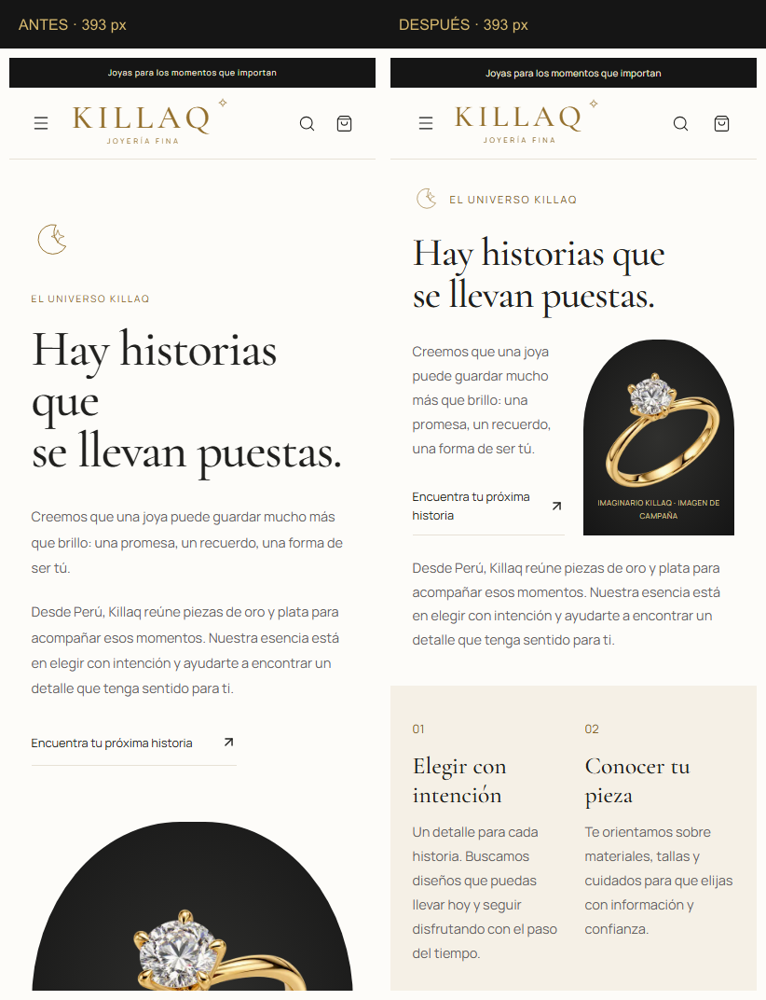
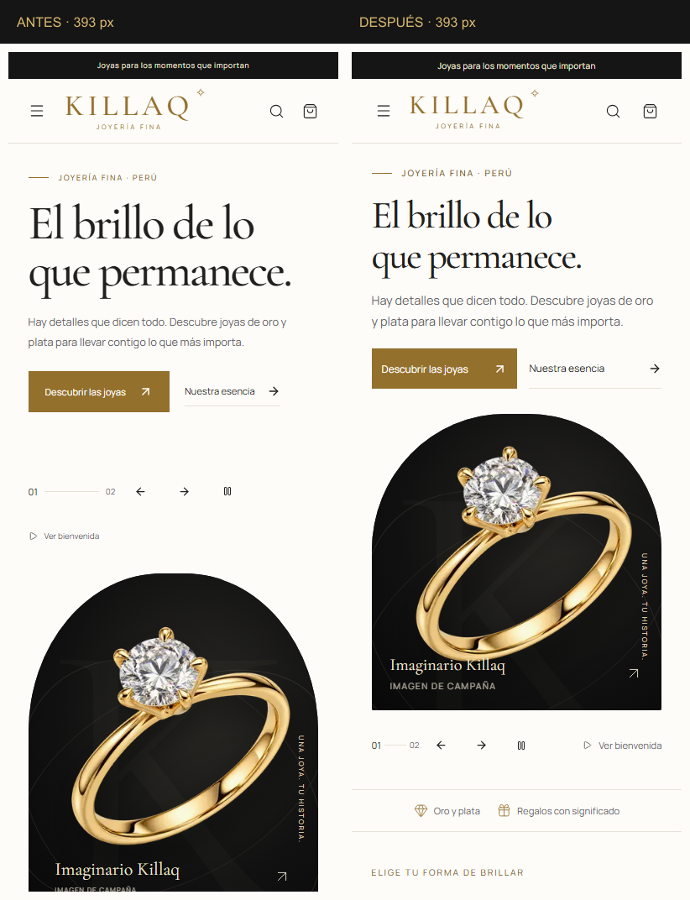

# Killaq · Revisión responsive

9 de octubre de 2026. Referencia original: commit `97c719e4b93b11131a0bf3613e0e829950e5dc9c` de la web publicada.

La tienda conserva su pasarela de dos campañas, imágenes, logo, tipografías y dirección artística. La intervención concentra la composición nueva en celulares y tablets, con correcciones puntuales de contraste y foco compartidas con escritorio. No modifica precios, existencias, consultas del catálogo ni procesos de autenticación o compra.

**1. Diagnóstico y criterio de diseño**

Se revisaron la arquitectura Next.js, SiteChrome, los contextos de carrito, autenticación y configuración, el catálogo conectado a Supabase y sus estilos por página. Antes de cambiar estilos se capturaron 13 rutas/estados públicos a seis anchos: 78 capturas originales. Las páginas protegidas se comprobaron después en una aplicación aislada con datos de prueba locales.

| Sección | Problema observado | Resolución |
| --- | --- | --- |
| Inicio | El espacio reservado para texto y los controles separaban demasiado la fotografía del mensaje. | Imagen de campaña cerca de los CTA; controles después de la imagen; tipografía y alturas fluidas. |
| Categorías | Cinco categorías y todos sus estilos hacían extensa la exploración móvil; las imágenes eran pequeñas en tablets. | Dos columnas en celulares; Charms como cierre horizontal; estilos desplegables; tres columnas en tablets. |
| El universo Killaq | Título, párrafos, CTA y fotografía quedaban muy alejados, seguidos de tres bloques largos. | Fotografía junto al primer párrafo y CTA, título más equilibrado y bloques numerados con composición propia. |
| Catálogo | Los filtros ocupaban espacio en el flujo y faltaba un resumen de la selección. | Panel modal móvil, ordenamiento al lado del botón, filtros aplicados con eliminación individual y limpieza. |
| Atención personalizada | Taller, pasos y formulario producían un recorrido largo; movimiento reducido generaba un error de hidratación React. | Alturas y proporciones adaptadas, pasos en grilla y corrección de la primera renderización de la animación. |
| Navegación y footer | Controles estrechos, textos pequeños, footer alto y separación del menú respecto al header durante el scroll. | Áreas táctiles amplias, menú alineado al header sticky y grupos de enlaces desplegables en celulares. |
| Panel admin | A 1024 px la tabla de productos ampliaba el contenedor principal hasta 1227 px. | Contenedor flexible que puede reducirse; desplazamiento de las tablas dentro de su propia región, accesible por teclado. |

Los breakpoints siguen las necesidades del contenido: 700 px para la recomposición editorial, 900 px para filtros y tablas, y 1100 px para navegación y ajustes de tablet. Este criterio y las imágenes adaptativas siguen las recomendaciones de [responsive design de web.dev](https://web.dev/articles/responsive-web-design-basics).

La selección visible y la eliminación individual de filtros responden a la necesidad de que el visitante entienda y pueda ajustar su búsqueda, descrita por [Baymard sobre filtros aplicados](https://baymard.com/research-articles/how-to-design-applied-filters). También se consultaron las estructuras editoriales de Tiffany y Aesop como referencias; no se copiaron sus layouts ni se realizó una auditoría de sus versiones móviles.

**2. Cambios por formato**

En celulares, la pasarela mantiene el arco negro y muestra la joya completa. Se equilibran el título y el mensaje, los dos CTA conservan su presencia y los controles quedan cerca de la campaña. La segunda campaña de collares conserva los mismos controles de avance, retroceso y pausa. La bienvenida puede omitirse con el botón o Escape y devuelve el foco a su origen.

Las categorías conservan las cinco fotografías. «Estilos» permite abrir sus subcategorías sin ocupar todo el recorrido inicialmente. Charms combina imagen y texto en una fila. La historia de marca conserva su fotografía y textos; los beneficios aprovechan dos columnas. El footer mantiene sus 14 enlaces, teléfono, correo, ciudad y frases, con contacto siempre visible y grupos de navegación que se pueden desplegar.

«El universo Killaq» conecta el encabezado con la fotografía y el primer párrafo. A partir de 380 px, los bloques 01 y 02 comparten una fila y 03 cierra a todo el ancho; en pantallas compactas se usan filas numeradas. El FAQ mantiene `details`/`summary` y se opera con teclado.

En tablets, el inicio y el taller mantienen imagen y texto en paralelo; las categorías usan tres columnas. El formulario de atención personalizada recibe más ancho que su introducción. Desde 901 px el catálogo mantiene la barra lateral, mientras que las tablets más estrechas usan el panel de filtros. Las tablas administrativas conservan todas sus columnas dentro de un área desplazable.

Los formularios de acceso, perfil, reclamaciones y atención personalizada tienen entradas legibles y foco visible. Carrito, ofertas, ficha de producto y páginas ausentes ajustan espacios, grillas y botones. No se añadió una barra inferior permanente ni se convirtieron las secciones en nuevos carruseles.

**3. Protección de escritorio y accesibilidad**

Las 26 comparaciones de escritorio —13 rutas/estados a 1440 y 1920 px— mantienen exactamente la altura de página, dimensiones de las secciones medidas y enlaces del footer. Se compararon los píxeles sin máscaras ni tolerancias que oculten diferencias.

Las diferencias visuales están identificadas: textos dorados pequeños pasan de `#94702d` a `#876629`; la frase pequeña del logo del footer utiliza el dorado claro ya existente; los enlaces dentro de los textos de acceso llevan subrayado. El logo principal, fotografías y fondos mantienen sus colores originales. En 24 capturas, los píxeles distintos representan entre 0.015683 % y 0.137342 %. Las otras dos corresponden al catálogo de matrimonio, donde el resumen de filtros aplicado añade contenido solicitado dentro de la composición existente: 5.118162 % a 1440 px y 3.838248 % a 1920 px.

El ajuste de texto eleva su contraste de 4.44:1 a 5.17:1 sobre blanco cálido, y de 4.01:1 a 4.67:1 sobre crema. Se hizo para superar el mínimo de 4.5:1 para texto normal de [WCAG 2.2, contraste mínimo](https://www.w3.org/WAI/WCAG22/Understanding/contrast-minimum.html), sin cambiar el dorado de la marca en botones y elementos decorativos.

Los controles principales móviles usan áreas de 44–48 px, foco visible y nombres accesibles. Los 44 px son la meta de comodidad de este proyecto; [WCAG 2.2, tamaño mínimo de objetivos](https://www.w3.org/WAI/WCAG22/Understanding/target-size-minimum.html) establece 24 px con excepciones. El panel de filtros usa un diálogo nativo con Escape, cierre visible y devolución del foco. El menú permite volver desde categorías y cerrar con Escape.

El movimiento reducido evita la bienvenida automática, detiene la rotación y presenta la pieza artesanal terminada sin animación. `useSyncExternalStore` garantiza una primera renderización coherente entre servidor y cliente, eliminando el error React 418 detectado en la versión original.

**4. Archivos y componentes**

| Área | Archivos principales |
| --- | --- |
| Inicio y categorías | `src/app/page.tsx`, `src/app/page.module.css`, `HeroCarousel.module.css` |
| Página de marca | `src/app/nosotros/page.tsx`, `src/app/nosotros/page.module.css` |
| Filtros reutilizados | `ColeccionesClient.tsx`, nuevo `CatalogFilters.tsx`, `src/app/colecciones/page.module.css` |
| Navegación y contacto | `Navbar.tsx`, `Navbar.module.css`, `Footer.tsx`, `Footer.module.css`, nuevo `FooterGroup.tsx` |
| Animaciones | `ArtisanAnimation.tsx`, `ArtisanAnimation.module.css`, `BrandIntro.module.css`, nuevo `src/hooks/useMotionPreference.ts` |
| Contraste y foco | `src/app/globals.css`, `Brand.module.css`, estilos de textos en las páginas afectadas |
| Rutas adicionales | Estilos de `(auth)`, `carrito`, `ofertas`, `perfil`, `libro-reclamaciones`, `producto/[slug]`, `not-found`, `ProductCard` y `ExclusiveSpotlight` |
| Administración | `admin.module.css`, `crud.module.css`; regiones de tabla en `admin/productos`, `admin/carrusel` y `admin/videos` |
| Verificación | `audit-responsive.mjs`, `test-responsive-ui.mjs`, `compare-responsive.mjs`, `audit-layout-stability.mjs`, referencia de enlaces en `scripts/fixtures/responsive-footer.json` |
| Dependencias y documentación | `package.json`, `package-lock.json`, `.gitignore`, `.vercelignore`, `README.md`, este informe y `screenshots/responsive/` |

Playwright y axe son dependencias de desarrollo para pruebas. No se incorporó una nueva librería al código de la tienda ni una dependencia para decoración. Las imágenes existentes continúan con `next/image`, `sizes` y `srcset`; se ajustó la resolución solicitada por las categorías de tablet y la fotografía pequeña de la página de marca. La imagen principal conserva carga inmediata y los espacios de las fotografías mantienen proporciones reservadas.

**5. Pruebas y comparación visual**

| Comprobación | Resultado |
| --- | --- |
| `npm run lint` | Sin errores. |
| `npm run build` | Compilación y TypeScript correctos; 19 páginas generadas. |
| `npm test` | 11 pruebas de carrito/configuración y comprobaciones de las cinco migraciones, idempotencia y permisos, aprobadas en PostgreSQL local. |
| Auditoría responsive | 156 capturas: 13 rutas/estados × 12 anchos, sin desbordamiento horizontal de página, textos desbordados detectados, imágenes rotas ni errores de JavaScript. |
| Interacciones | 33 escenarios aprobados: menú, sticky, búsqueda, filtros, teclado, categorías, footer, FAQ, campañas, bienvenida, taller, galería, talla, carrito y vistas protegidas locales. |
| axe | 100 estados revisados con reglas WCAG A/AA, sin infracciones automáticas detectadas. Incluye páginas públicas, panel de filtros, menú, footer desplegado, ficha/carrito y administración local. |
| Estabilidad inicial | Inicio, marca y atención personalizada a 320, 393, 820 y 1440 px: suma de desplazamientos observados entre 0 y 0.020567; imágenes visibles cargadas. Medición de laboratorio local, no métrica de usuarios reales. |
| Dependencias de producción | `npm audit --omit=dev`: cero vulnerabilidades reportadas. |
| Supabase | Consulta pública ejecutada; no hubo escrituras remotas. |

Anchos: **320, 360, 375, 393, 414, 430, 768, 820, 1024, 1280, 1440 y 1920 px**. Rutas/estados: inicio, nosotros, catálogo, ofertas, atención personalizada, carrito vacío, login, registro, reclamaciones, perfil sin sesión, producto ausente, colección de matrimonio y página ausente. Galería, selección de talla y carrito con piezas se verificaron en los mismos doce anchos mediante datos aislados; las seis páginas del admin y perfil autenticado se revisaron a seis anchos.

En el entorno aislado se comprobó añadir una pieza con talla, aumentar hasta el stock disponible, evitar excederlo, conservar el carrito y retirar la pieza. Las consultas por WhatsApp se comprobaron leyendo el enlace generado; no se enviaron mensajes. El acceso de prueba no usa credenciales del proyecto remoto.

| Página a 393 px, estado inicial | Antes | Después | Reducción de recorrido |
| --- | ---: | ---: | ---: |
| Inicio | 5488 px | 4551 px | 17.1 % |
| El universo Killaq | 3305 px | 2211 px | 33.1 % |
| Catálogo | 1869 px | 1347 px | 27.9 % |
| Atención personalizada | 4148 px | 3487 px | 15.9 % |

Las alturas incluyen toda la página y el footer con sus grupos cerrados inicialmente. No se eliminaron textos comerciales ni datos de contacto para lograr la reducción.

Comparaciones de los primeros 1000 px del recorrido:





Las 14 capturas completas seleccionadas y el visor `screenshots/responsive/comparacion.html` permiten revisar móvil, tablet y escritorio. `screenshots/responsive/comparacion.json` contiene las dimensiones y diferencias de píxeles. Las capturas completas de la matriz y resultados detallados quedan localmente en `artifacts/responsive/`, excluidos de Git y del despliegue.

Para repetir la revisión con el servidor local en ejecución:

```bash
npx playwright install chromium
npm run audit:responsive -- after http://127.0.0.1:3000
npm run test:responsive -- http://127.0.0.1:3000
npm run audit:stability -- http://127.0.0.1:3000
```

`compare:responsive` necesita una auditoría anterior guardada; no crea una referencia artificial con la versión nueva. El segundo argumento de `test:responsive` es opcional y solo admite una instancia aislada de prueba en localhost, con su propio backend local. La prueba pública estándar no inicia sesiones ni guarda datos. Chromium debe estar instalado en el entorno que ejecute los scripts.

**6. Estado pendiente y límites de la revisión**

No se creó ni modificó ningún archivo SQL en esta iteración. La comprobación remota aún encuentra cero productos publicados, tablas de videos y reclamaciones ausentes y cambios 004/005 sin aplicar. Sigue vigente la entrega manual numerada `001` → `005`, documentada en `src/sql/README.md`. El apartado exclusivo sigue oculto mientras no haya una pieza real publicada, con imagen y una colección activa.

La prueba del admin, perfil, producto y carrito con existencias utilizó una copia aislada y un backend en memoria en localhost. No demuestra escrituras administrativas remotas ni sustituye probar el catálogo comercial una vez cargado. Se mantienen los canales de contacto existentes; su confirmación comercial sigue pendiente según el informe anterior.

El navegador integrado no pudo inicializarse por un error de sus archivos de ejecución. Las capturas e interacciones se realizaron con Chromium de Playwright en Windows, autorizado para esta revisión. También se comprobó la carga con emulación táctil. No se probaron celulares físicos, Safari o Firefox ni lectores de pantalla; la revisión automática no constituye una certificación completa de accesibilidad.

Persisten los avisos de desarrollo de la cadena ESLint documentados anteriormente; la auditoría de dependencias de producción está limpia. Las tablas administrativas usan desplazamiento horizontal deliberado dentro de su propia región para conservar todas las columnas, sin ampliar la página.

Antes de una venta real falta aplicar las migraciones pendientes, cargar productos y fotografías definitivas y revisar la operación comercial con la cuenta administrativa real. Como siguiente mejora de producto, conviene incorporar una guía de tallas y cuidados con contenido confirmado por los dueños; pagos y pedidos automáticos requieren un trabajo separado sobre la operación de la tienda.
